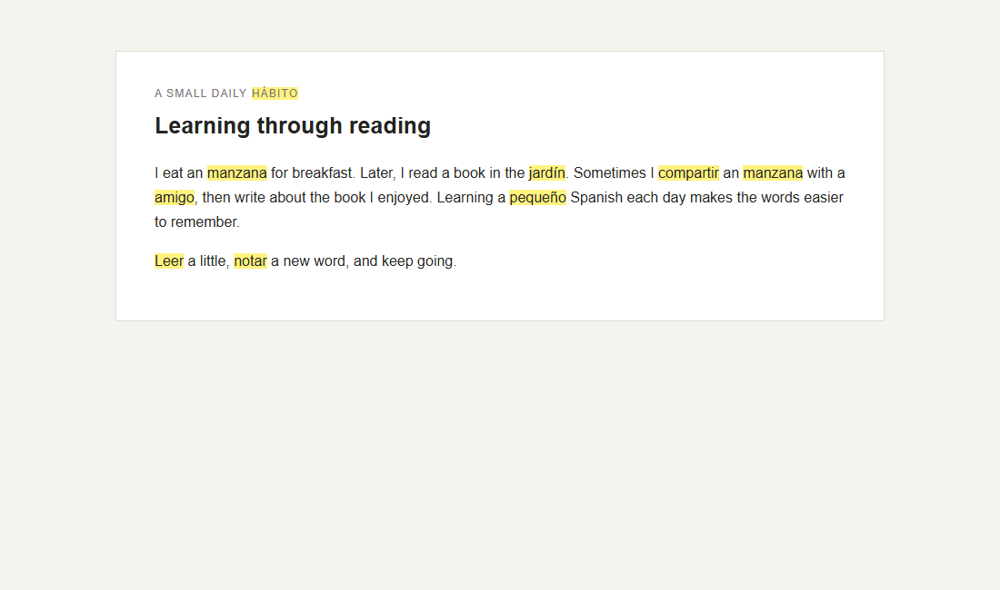
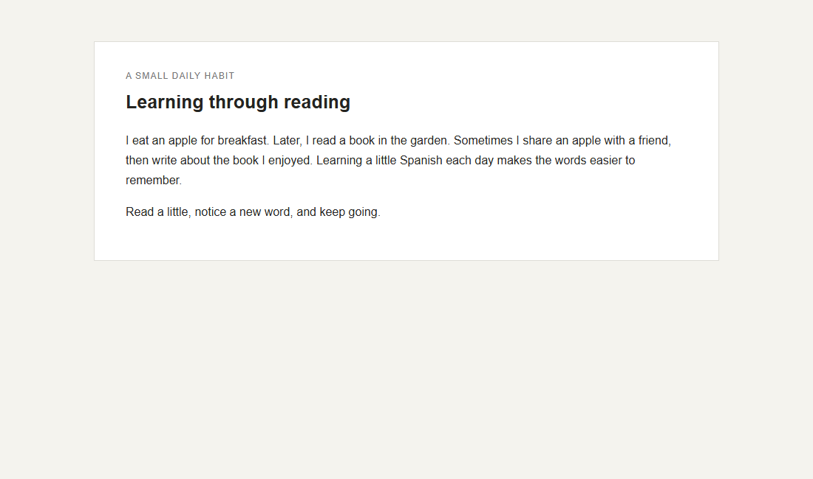
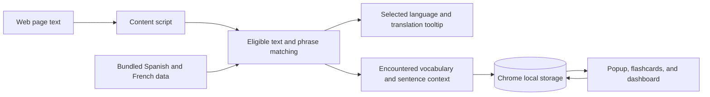

# LinguaPop

**Practice a language while you browse.** LinguaPop is a Manifest V3 Chrome extension that replaces selected English words and phrases on web pages with Spanish or French. Encountered vocabulary is saved for review.



[Try the v0.1.0 release](https://github.com/ayomel/LinguaPop/releases/download/v0.1.0/linguapop-v0.1.0.zip) · [Build the current source](#run-from-source) · [Engineering case study](docs/engineering-case-study.md) · [Privacy policy](https://ayomel.github.io/LinguaPop/privacy-policy.html)

## What it does

- Replaces eligible page text at a percentage you choose. Complete phrases are checked before individual words; editable fields, code, and interactive controls are skipped.
- Lets you select a replacement to see its translation, then review encountered vocabulary with flashcards.
- Tracks review progress with a daily goal and a schedule based on your "Remembered" or "Need practice" answers.
- Lets you pause replacements globally or for a specific site.

The main engineering challenge is changing page text without breaking the page. LinguaPop uses reversible replacements and batches dynamic page updates while avoiding observer loops. Stable candidate selection keeps the chosen replacements predictable as settings change. The [case study](docs/engineering-case-study.md) describes these decisions and the checks that cover them.

## Defaults

| Setting | New-install default |
| --- | --- |
| LinguaPop | On |
| Replacement percentage | 5% |
| Vocabulary level | Beginner |
| Practice language | English to Spanish |

Change these settings in the extension popup. The French starter set includes 215 beginner words and 20 phrases. Spanish and French vocabulary are bundled separately, and each language pair has its own encounters, review schedule, and daily review progress.

## Before and after

The same reading sample before and after LinguaPop replaces eligible words and phrases:

| Before LinguaPop | After LinguaPop |
|:--:|:--:|
|  |  |

## Permissions and data

LinguaPop processes eligible page text in your browser on HTTP and HTTPS sites. For each encountered word, it saves the most recently encountered containing sentence, up to 500 characters, so flashcard reviews can show context. Settings, encountered words, these sentence snippets, and review progress are stored in `chrome.storage.local` on your device. LinguaPop does not send page text or learning data to a remote service.

The `storage` permission is used for local settings and learning data. The `activeTab` permission lets the popup read the current tab's URL to show its per-site toggle.

## How it works



The runtime uses a language-neutral `LanguagePair` model backed by the bundled word and phrase dictionaries.

## Try the release

Download the [LinguaPop v0.1.0 ZIP](https://github.com/ayomel/LinguaPop/releases/download/v0.1.0/linguapop-v0.1.0.zip) and extract it. In Chrome, open `chrome://extensions`, enable Developer mode, choose **Load unpacked**, and select the extracted folder containing `manifest.json`.

## Run from source

Requirements: Node.js 20.19.x or Node.js 22.12 or newer, pnpm 10.22.0, and Google Chrome.

```sh
git clone https://github.com/ayomel/LinguaPop.git
cd LinguaPop
pnpm install
pnpm build
```

In Chrome, open `chrome://extensions`, enable Developer mode, choose **Load unpacked**, and select the generated `dist` directory. To open the sample reading page, start the development server in the project directory:

```sh
pnpm dev
```

Then open `http://localhost:5173/demo.html` in Chrome. Use the popup to choose Spanish or French and adjust the replacement percentage, then refresh the page. Select a replacement to see its translation. Pause LinguaPop to restore the original text, and check that the sample editable field and code remain unchanged.

Choose **Open vocabulary dashboard** from the popup to review progress, set a daily goal, or use its flashcards. The dashboard lists words in progress and graduated words. Choose **Export for Anki (.tsv)** to download encountered vocabulary with translations and learning details. Reviews are also available from the popup.

## Checks

```sh
pnpm build
pnpm test
pnpm dictionary:check
pnpm manifest:check
```

`pnpm build` checks TypeScript and bundles the extension. `pnpm test` runs the automated suite, `pnpm dictionary:check` validates bundled vocabulary, and `pnpm manifest:check` checks permissions and page match scope.

## Code map

- `manifest.config.ts` and `src/content.ts` define the Manifest V3 extension entry points.
- `src/content/` contains webpage matching and translation tooltip behavior.
- `src/data/` contains the language-pair adapter and bundled vocabulary.
- `src/learning/` contains encounters, review scheduling, flashcards, and the dashboard.
- `src/popup.ts` and `src/settings.ts` implement extension controls and saved preferences.
