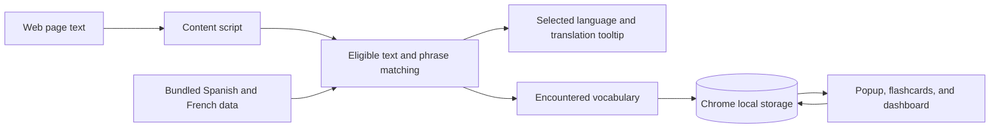

# LinguaPop

**Practice a language while you browse.** LinguaPop is a Manifest V3 Chrome extension that replaces some eligible English words and phrases on web pages with Spanish or French. It saves encountered vocabulary for review later.

[Install a release](#try-it-without-building) · [Run the current source](#run-it-locally) · [Engineering case study](docs/engineering-case-study.md) · [Privacy policy](https://ayomel.github.io/LinguaPop/privacy-policy.html)

## Engineering highlights

The main challenge is changing a page without breaking it. LinguaPop works with eligible text nodes, makes replacements reversible, and batches dynamic page updates while avoiding observer loops. Stable candidate selection keeps replacements predictable as settings change. Vocabulary and learning progress stay on the device.

The [case study](docs/engineering-case-study.md) explains those decisions and what the automated checks cover.

## What it does

- Choose how much page text changes and which vocabulary level to use. You can also pause LinguaPop everywhere or on a specific site.
- Replace complete phrases before individual words. LinguaPop skips editable fields, code, and interactive controls.
- Select a replacement to see its translation, then review encountered words with flashcards.
- Track review progress with a daily goal and a schedule based on explicit "Remembered" or "Need practice" answers.

Settings, encountered words, and review progress are saved in `chrome.storage.local`. Choose English-to-Spanish or English-to-French in the popup. Each pair has its own word encounters, review schedule, and daily review progress.

## Permissions and data

The `storage` permission saves your settings, site overrides, encountered words, and review progress on this device. The `activeTab` permission lets the popup read the current tab’s URL and show its per-site toggle. LinguaPop works with page text on HTTP and HTTPS sites. It does not send page text or learning data to a remote service.

## How it works



The runtime uses a language-neutral `LanguagePair` model. Spanish and French words and phrases are stored in separate JSON files; the French starter set includes 215 beginner words and 20 phrases. Within an eligible text node, longer phrases take priority over individual words.

## Try it without building

Download the [LinguaPop v0.1.0 release](https://github.com/ayomel/LinguaPop/releases/tag/v0.1.0) and unzip it. In Chrome, open `chrome://extensions`, enable Developer mode, choose **Load unpacked**, and select the extracted folder that contains `manifest.json`.

## Run it locally

You’ll need Node.js 20.19 or newer in the 20.x line, or Node.js 22.12 or newer, along with pnpm and Google Chrome.

```sh
pnpm install
pnpm build
```

In Chrome, open `chrome://extensions`, enable Developer mode, choose **Load unpacked**, and select the generated `dist` directory.

Read the [privacy policy](https://ayomel.github.io/LinguaPop/privacy-policy.html).

To try the sample reading page, run `pnpm dev` in another terminal and open `http://localhost:5173/demo.html` in Chrome:

```sh
pnpm dev
```

Open the LinguaPop popup, choose English to Spanish or English to French, raise the replacement percentage, and refresh the page. Select a replacement to see its translation. The editable field and code sample show content LinguaPop skips.

## Quick walkthrough

With the current source built and loaded in Chrome, open the local sample reading page described above:

1. Choose Spanish or French in the popup and increase the replacement percentage.
2. Refresh the page and select a replaced word or phrase to see its translation.
3. Change the percentage or pause the extension to see the original text restored.
4. Check that editable fields and code samples remain unchanged.
5. Open vocabulary review and mark a word as remembered or needing practice.

## Checks

```sh
pnpm build
pnpm test
pnpm dictionary:check
pnpm manifest:check
```

`pnpm build` checks TypeScript and bundles the extension. After the build, run `pnpm manifest:check` to check permissions and page match scope. `pnpm dictionary:check` validates the word and phrase data.

## Code map

- `manifest.config.ts` and `src/content.ts` define the Manifest V3 extension entry points.
- `src/content/` contains webpage matching and translation tooltip behavior.
- `src/data/` contains the language-pair adapter and bundled vocabulary.
- `src/learning/` contains encounters, review scheduling, flashcards, and the dashboard.
- `src/popup.ts` and `src/settings.ts` implement extension controls and saved preferences.
