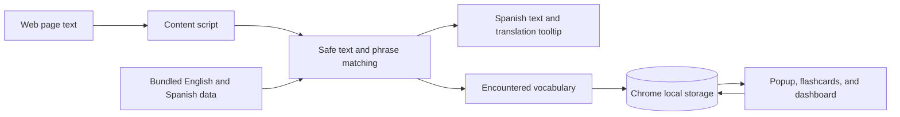

# LinguaPop

**Practice Spanish while you browse.** LinguaPop is a Manifest V3 Chrome extension that replaces a chosen share of eligible English words and phrases on web pages with Spanish. It saves encountered vocabulary for later review.

See the [engineering case study](docs/engineering-case-study.md) for the problem, implementation choices, and verification boundaries.

## What it does

- Adjust how much page text changes, choose a vocabulary level, and pause LinguaPop globally or for one site.
- Match complete phrases before individual words, and skip editable fields, code, and interactive controls.
- Open a translation tooltip, collect encountered words, and review them with flashcards.
- Track review progress with a daily goal and a schedule based on explicit "Remembered" or "Need practice" answers.

Settings, encountered vocabulary, and review progress are stored with `chrome.storage.local`. The extension ships English-to-Spanish vocabulary as static word and phrase data. English to Spanish is the only language pair currently available.

## How it fits together



The runtime uses a language-neutral `LanguagePair` model, while the shipped English and Spanish dictionaries remain in separate JSON files. Longer phrase matches take precedence over single-word matches within an eligible text node.

## Run it locally

You'll need Node.js 20.19 or newer in the 20.x line, Node.js 22.12 or newer, pnpm, and Google Chrome.

```sh
pnpm install
pnpm build
```

In Chrome, open `chrome://extensions`, enable Developer mode, choose **Load unpacked**, and select the generated `dist` directory.

To try the extension on the sample reading page, start the Vite server in a second terminal and open `http://localhost:5173/demo.html` in Chrome:

```sh
pnpm dev
```

Open the LinguaPop popup, raise the replacement percentage to make the sample easier to see, then refresh the page. Select a Spanish replacement to open its translation. The editable field and code sample show page content that LinguaPop skips.

## Checks

```sh
pnpm build
pnpm test
pnpm dictionary:check
```

`pnpm build` runs the TypeScript check before bundling the extension. The dictionary check validates both word and phrase data.

## Code map

- `manifest.config.ts` and `src/content.ts` define the Manifest V3 extension entry points.
- `src/content/` contains webpage matching and translation tooltip behavior.
- `src/data/` contains the language-pair adapter and bundled vocabulary.
- `src/learning/` contains encounters, review scheduling, flashcards, and the dashboard.
- `src/popup.ts` and `src/settings.ts` implement extension controls and saved preferences.

## Current scope

LinguaPop currently ships one pair: English to Spanish. The language-pair model gives the runtime a shared contract for a future pair, but additional languages are not included yet.
